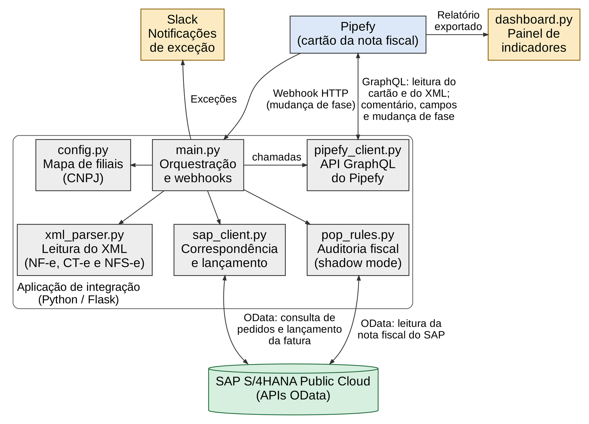
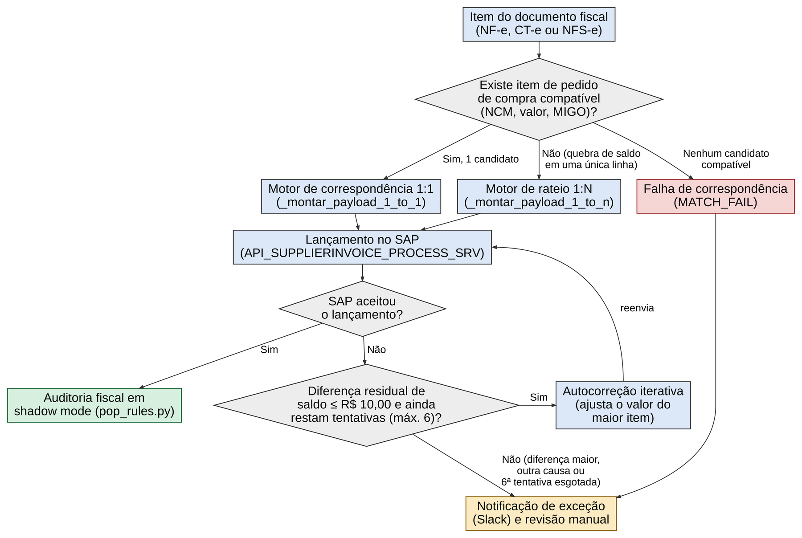
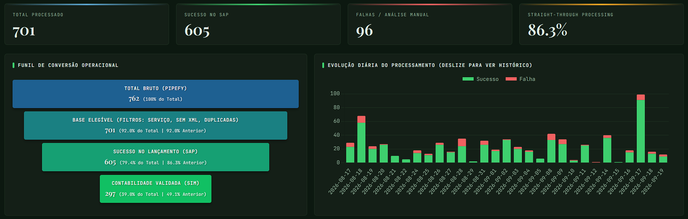

# Tax automation: Pipefy → SAP S/4HANA Public Cloud

[🇧🇷 Português](README.md) | 🇺🇸 English

Integration that automatically posts Brazilian supplier invoices (NF-e, CT-e and NFS-e) to Accounts Payable in **SAP S/4HANA Public Cloud** from **Pipefy** cards, with automatic purchase order matching, self-correction of common failures, tax auditing and **Slack** notifications.

> I built this project at a Brazilian manufacturer, where it runs in production. This repository holds the code structure for portfolio purposes: tax IDs (CNPJ), credentials, environment IDs, document numbers and real names were removed or replaced with fictitious values.

## Production results

| Metric | Value |
|---|---|
| Cards with XML posted without manual intervention | 95% |
| Time per posting (median) | about 21 s, versus about 3 min manually (88% less) |
| Supported documents | NF-e, CT-e and NFS-e (national standard) |
| Root causes classified on the dashboard | 20+ |

SAP offers no native solution for receiving supplier invoices in Brazil on the Public Cloud edition (CIM and DRC inbound do not cover it), so the integration was built on S/4HANA's own OData and SOAP APIs, without changing the ERP core. The project is also the subject of my Computer Science capstone (IF Goiano).

## Architecture



1. An analyst moves the card to the trigger phase and Pipefy sends a signed webhook.
2. The Flask application replies immediately and processes in the background: it reads the XML files, identifies the branch by the recipient's tax ID and fetches the purchase order.
3. Invoice items are matched to purchase order items (1:1 by scoring or 1:N split) and the supplier invoice is created through `API_SUPPLIERINVOICE_PROCESS_SRV`.
4. After posting, a shadow-mode audit compares each tax's deductibility with the branch's tax procedure, the card gets a comment with the result and moves to the next phase.
5. Exceptions go to the Slack channel of the responsible team, with the cause and a suggested action.



## Technical highlights

- **Net amount for SAP:** item matching uses gross value and NCM code, but the payload sends the net amount (gross minus ICMS, PIS and COFINS computed in the pricing view), avoiding double taxation and rounding gaps.
- **Balance self-correction:** cent-level differences are adjusted on the highest-value item, capped at BRL 10.00 and 6 attempts.
- **Goods receipt self-healing:** an already-used goods receipt reference is swapped for the next one in the queue; a guard prevents invoicing more than was received.
- **Commercial checks:** installments and due dates simulated against the XML; anti-fraud by tax ID; duplicates detected without retrying.
- **Installment adjustment via SOAP:** automatic correction of due dates and amounts in Accounts Payable (`JournalEntryBulkChangeRequest_In`, with WS-ReliableMessaging).
- **Risk score (0 to 100)** to prioritize human review.

## Dashboard



## Structure

```
src/
  main.py                 orchestration, webhooks and manual posting web app
  config.py               settings and branch map (fictitious example)
  pipefy_client.py        Pipefy GraphQL API
  xml_parser.py           NF-e, CT-e and NFS-e parsing into a single structure
  sap_client.py           purchase orders, matching and posting (OData)
  sap_soap_client.py      SOAP services with WS-ReliableMessaging
  pop_rules.py            shadow-mode tax audit
  fase_pagamento.py       installment check in the payment phase
  ajuste_parcelas.py      installment adjustment and clearing in Accounts Payable
  validacao_logistica.py  invoice validation before goods receipt
tools/
  dashboard.py            KPI dashboard (Flask + Chart.js)
  monitor_compras.py      payment terms monitor
  relatorio_ncm.py        weekly NCM audit
  relatorio_*.py          GL account and reversal reports
web/
  app_lancamento.html     single-page app for manual posting
```

## How to run

```bash
python -m venv .venv && source .venv/bin/activate
pip install -r requirements.txt
cp .env.example .env      # fill in your environment credentials
cd src && python main.py  # or: gunicorn -w 2 -b 0.0.0.0:8009 main:app
```

You need an SAP S/4HANA Public Cloud tenant with communication scenarios for the APIs used (supplier invoices, purchase orders, material documents, Brazilian fiscal documents and journal entries) and a Pipefy pipe with a webhook to `/webhook/pipefy`.

## Tech stack

Python 3 · Flask · lxml · requests · zeep · pandas · Chart.js · SAP S/4HANA Public Cloud (OData V2/V4, SOAP, CDS views) · Pipefy (GraphQL, webhooks) · Slack API · Linux (systemd, gunicorn, Apache)

## Author

João Victor Guidi de Lima · [LinkedIn](https://www.linkedin.com/in/joão-lima-8b512) · [GitHub](https://github.com/Joao-2003)
