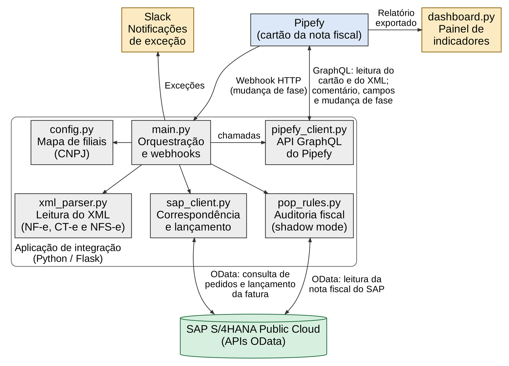
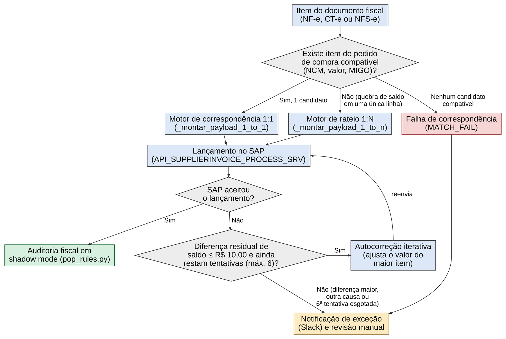
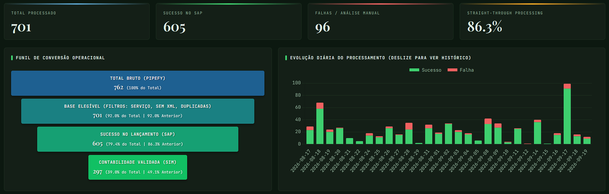

# Automação fiscal Pipefy → SAP S/4HANA Public Cloud

🇧🇷 Português | [🇺🇸 English](README.en.md)

**▶️ [Abrir a demonstração](https://joao-2003.github.io/sap-pipefy-invoice-automation/)**: painel de lançamentos e monitor de compras com dados fictícios, direto no navegador.

Integração que lança automaticamente notas fiscais de fornecedores (NF-e, CT-e e NFS-e) no Contas a Pagar do **SAP S/4HANA Public Cloud** a partir de cards do **Pipefy**, com correspondência automática com pedidos de compra, autocorreção de falhas comuns, auditoria fiscal e notificações no **Slack**.

> Projeto desenvolvido por mim em uma indústria brasileira e usado em produção. Este repositório traz a estrutura do código para portfólio: CNPJs, credenciais, IDs de ambiente, números de documentos e nomes reais foram removidos ou trocados por valores fictícios.

## Resultados em produção

| Indicador | Valor |
|---|---|
| Cards com XML lançados sem intervenção | 95 % |
| Tempo por lançamento (mediana) | cerca de 21 s, contra cerca de 3 min no processo manual (88 % menos) |
| Documentos suportados | NF-e, CT-e e NFS-e (padrão nacional) |
| Causas-raiz classificadas no painel | mais de 20 |

O SAP não oferece solução nativa para receber faturas no Brasil na edição Public Cloud (CIM e DRC inbound não atendem), por isso a integração foi construída sobre as APIs OData e SOAP do próprio S/4HANA, sem alterar o núcleo do ERP. O projeto também é tema do meu TCC em Ciência da Computação (IF Goiano).

## Arquitetura



1. O analista move o card para a fase de disparo e o Pipefy envia um webhook assinado.
2. A aplicação (Flask) responde na hora e processa em segundo plano: lê os XML, identifica a filial pelo CNPJ do destinatário e busca o pedido de compra.
3. Os itens da nota são casados com os itens do pedido (1:1 por pontuação ou rateio 1:N) e a fatura é criada pela API `API_SUPPLIERINVOICE_PROCESS_SRV`.
4. Depois do lançamento, a auditoria em shadow mode compara a dedutibilidade de cada imposto com o POP fiscal, o card recebe um comentário com o resultado e segue de fase.
5. Exceções vão para o canal do Slack da área responsável, com a causa e a ação sugerida.



## Destaques técnicos

- **Valor líquido para o SAP:** a busca do item usa valor bruto e NCM, mas o payload envia o líquido (bruto menos ICMS, PIS e COFINS calculados na visão de preços), evitando imposto em dobro e diferenças de arredondamento.
- **Autocorreção de saldo:** diferenças de centavos são ajustadas no item de maior valor, com limite de R$ 10,00 e até 6 tentativas.
- **Autorregeneração de MIGO:** referência de entrada de mercadorias já usada é trocada pela próxima da fila; uma trava impede faturar acima do recebido.
- **Validações comerciais:** parcelas e vencimentos simulados contra as duplicatas do XML; antifraude por CNPJ; duplicidade detectada sem nova tentativa.
- **Ajuste de parcelas por SOAP:** correção automática de vencimentos e valores no Contas a Pagar (`JournalEntryBulkChangeRequest_In`, com WS-ReliableMessaging).
- **Escore de risco (0 a 100)** para priorizar a revisão humana.

## Painel de indicadores



**[Ver a demonstração interativa](https://joao-2003.github.io/sap-pipefy-invoice-automation/)**: o painel de lançamentos e o monitor de compras rodando no navegador com dados fictícios. As páginas são geradas por `tools/gerar_demo_pages.py`, que renderiza o mesmo HTML dos apps Flask trocando o Pipefy e o SAP por dados inventados.

## Estrutura

```
src/
  main.py                 orquestração, webhooks e aplicação web de lançamento manual
  config.py               parâmetros e mapa de filiais (exemplo fictício)
  pipefy_client.py        API GraphQL do Pipefy
  xml_parser.py           leitura de NF-e, CT-e e NFS-e em estrutura única
  sap_client.py           pedidos, correspondência e lançamento (OData)
  sap_soap_client.py      serviços SOAP com WS-ReliableMessaging
  pop_rules.py            auditoria fiscal em shadow mode
  fase_pagamento.py       conferência das parcelas na fase de pagamento
  ajuste_parcelas.py      ajuste e compensação de parcelas no Contas a Pagar
  validacao_logistica.py  validação da nota antes do recebimento
tools/
  dashboard.py            painel de indicadores (Flask + Chart.js)
  monitor_compras.py      monitor de condições de pagamento
  relatorio_ncm.py        auditoria semanal de NCM
  relatorio_*.py          levantamentos de conta contábil e estornos
web/
  app_lancamento.html     aplicação de página única para lançamento manual
```

## Como executar

```bash
python -m venv .venv && source .venv/bin/activate
pip install -r requirements.txt
cp .env.example .env      # preencha com as credenciais do seu ambiente
cd src && python main.py  # ou: gunicorn -w 2 -b 0.0.0.0:8009 main:app
```

É preciso um tenant SAP S/4HANA Public Cloud com os cenários de comunicação das APIs usadas (faturas, pedidos, documentos de material, nota fiscal brasileira e lançamentos contábeis) e um pipe no Pipefy com webhook para `/webhook/pipefy`.

## Tecnologias

Python 3 · Flask · lxml · requests · zeep · pandas · Chart.js · SAP S/4HANA Public Cloud (OData V2/V4, SOAP, visões CDS) · Pipefy (GraphQL, webhooks) · Slack API · Linux (systemd, gunicorn, Apache)

## Autor

João Victor Guidi de Lima · [LinkedIn](https://www.linkedin.com/in/joão-lima-8b512) · [GitHub](https://github.com/Joao-2003)
